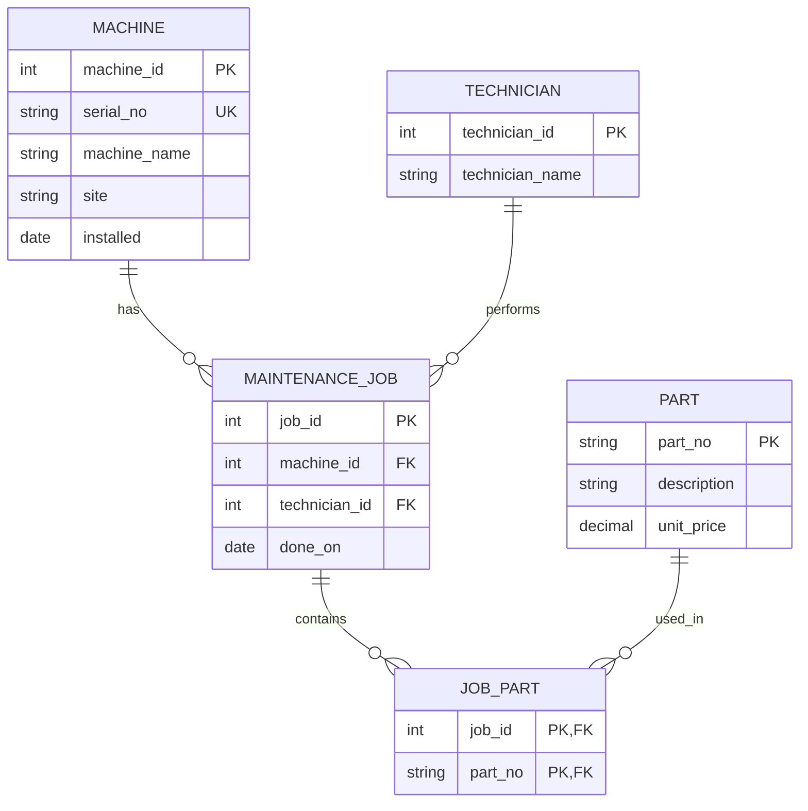

# Module 2 — ER Audit

## 1. Purpose

This audit reconstructs the intended entity-relationship model of the legacy maintenance database. The existing schema contains three tables: `machine`, `part`, and `maint_job`.

The audit identifies intended entities, attributes, keys, relationships, cardinalities, and integrity problems.

## 2. Entities, Attributes, and Intended Keys

### Machine

- `machine_name` — current machine name; not a declared primary key.
- `serial_no` — candidate natural key; should be unique.
- `site` — location of the machine.
- `installed` — installation date, currently stored as free text.
- Proposed primary key: `machine_id` (surrogate key).
- Natural key constraint: `serial_no` should be UNIQUE.

### Part

- `part_no` — intended natural key, but duplicates exist.
- `description` — part description.
- `unit_price` — price currently stored as TEXT.
- Proposed primary key: `part_no`, after resolving duplicates.

### MaintenanceJob

- `job_id` — intended primary key, but not declared as one.
- `machine_name` — machine reference stored as text, not a foreign key.
- `technician` — technician name stored as text.
- `done_on` — maintenance date.
- `parts_used` — comma-separated part numbers; violates first normal form (1NF).
- Proposed primary key: `job_id`.

### Technician

The intended model treats Technician as a separate entity because one technician can perform many maintenance jobs.

- Proposed primary key: `technician_id`.
- `technician_name` — technician name.

### JobPart (proposed junction table)

This table is needed to represent the many-to-many relationship between maintenance jobs and parts.

- `job_id` — foreign key to MaintenanceJob.
- `part_no` — foreign key to Part.
- Composite primary key: (`job_id`, `part_no`).

## 3. Reconstructed ER Diagram



This is a proposed corrected model, not the structure currently enforced by the legacy database.

## 4. Cardinality Findings

### Machine and MaintenanceJob — 1:n

One machine can have multiple maintenance jobs. Each maintenance job should refer to exactly one existing machine.

Observed query:

```sql
SELECT machine_name, COUNT(*) AS total_jobs
FROM maint_job
GROUP BY machine_name;
```

Result:

| machine_name | total_jobs |
|---|---:|
| cnc-01 | 2 |
| cnc-02 | 1 |
| cnc-05 | 1 |

The data shows that `cnc-01` is referenced by two jobs. However, `cnc-05` does not exist in the machine table, so that reference is an orphan.

### MaintenanceJob and Part — m:n

A maintenance job can use multiple parts, and a part can be used in multiple jobs. A junction table named `job_part` is needed.

Observed query:

```sql
SELECT job_id,
       parts_used,
       LENGTH(parts_used)
         - LENGTH(REPLACE(parts_used, ',', '')) + 1 AS n_parts
FROM maint_job
WHERE parts_used IS NOT NULL;
```

Result:

| job_id | parts_used | n_parts |
|---|---|---:|
| 1 | P-1001,P-1002 | 2 |
| 2 | P-1003 | 1 |
| 3 | P-1001 | 1 |

Job 1 contains two parts in one column. This makes direct relational joins unreliable.

### Part key uniqueness

Observed query:

```sql
SELECT COUNT(*) AS total_rows,
       COUNT(DISTINCT part_no) AS distinct_part_numbers
FROM part;
```

Result:

| total_rows | distinct_part_numbers |
|---:|---:|
| 4 | 3 |

There are four rows but only three distinct part numbers. The duplicate `P-1003` must be investigated before enforcing the proposed primary key.

### Machine name references

Observed query:

```sql
SELECT COUNT(DISTINCT machine_name) AS distinct_machine_names,
       COUNT(*) AS total_jobs
FROM maint_job;
```

Result:

| distinct_machine_names | total_jobs |
|---:|---:|
| 3 | 4 |

There are three distinct machine names across four jobs. This query counts references in maintenance jobs; it does not prove that all referenced machines exist.

## 5. Integrity Issues Identified

1. Primary keys are not declared in the legacy tables.
2. The natural key `part_no` contains duplicate values.
3. `maint_job.machine_name` is text instead of a foreign key.
4. `parts_used` contains comma-separated values.
5. `unit_price` is stored as TEXT instead of a numeric type.
6. `machine.installed` contains the invalid date value `unknown`.
7. `technician` is stored as a name instead of a reference to a Technician entity.

## 6. Conclusion

The legacy database stores maintenance data but does not enforce its intended relationships. The proposed model introduces explicit keys, foreign keys, a separate Technician entity, and a junction table for the many-to-many relationship between maintenance jobs and parts.

The corrected schema should be validated before migration, especially for duplicate part numbers, orphan maintenance jobs, and invalid dates.

## 7. Task 2 — Checking Database Problems

### Check 1: Machine Does Not Exist

**SQL query:**
```sql
SELECT m.job_id, m.machine_name
FROM maint_job m
LEFT JOIN machine x ON m.machine_name = x.machine_name
WHERE x.machine_name IS NULL;
```

**Result:** Job 3 uses machine `cnc-05`, but this machine is not listed in the machine table.

**Why is this a problem?** We cannot find the machine connected to this maintenance job. This can make maintenance records incorrect.

### Check 2: Duplicate Part Number

**SQL query:**
```sql
SELECT part_no, COUNT(*) AS copies
FROM part
GROUP BY part_no
HAVING COUNT(*) > 1;
```

**Result:** Part number `P-1003` appears twice.

**Why is this a problem?** The database has two records with the same part number. This can cause duplicate results when searching for parts.

### Check 3: Wrong Price Comparison

**SQL query:**
```sql
SELECT part_no, unit_price
FROM part
WHERE unit_price < '15';
```

**Result:** Only `P-1001`, with a price of `12.50`, appears. Part `P-1003`, which costs `9.90`, does not appear.

**Why is this a problem?** The price is stored as text instead of a proper number. Because of this, the database may compare prices incorrectly.

### Check 4: Incorrect Installation Date

**SQL query:**
```sql
SELECT machine_name, installed
FROM machine
WHERE installed NOT GLOB
'[0-9][0-9][0-9][0-9]-[0-9][0-9]-[0-9][0-9]';
```

**Result:** Machine `RANDOM-NAME` has the installation date `unknown`.

**Why is this a problem?** The database cannot use this value as a normal date. This can cause problems when checking when a machine was installed.

### Check 5: Parts Used in Maintenance Jobs

**SQL query:**
```sql
SELECT j.job_id, p.description
FROM maint_job j
JOIN part p ON p.part_no = j.parts_used;
```

**Result:** Job 2 shows `Coolant filter` twice. Job 3 shows `Ball bearing 6203`. Job 1 does not show its parts because `P-1001,P-1002` are stored together in one field.

**Why is this a problem?** The database cannot easily connect each part to a maintenance job when several part numbers are stored in one field. Some parts may be missing from reports.

### Conclusion

The database has several problems: a machine is missing, a part number is repeated, a price is stored as text, an installation date is invalid, and multiple part numbers are stored in one field.

These problems can lead to incorrect search results and reports. The database should be improved by using unique keys, correct data types, and a separate table to connect maintenance jobs with the parts they use. 
