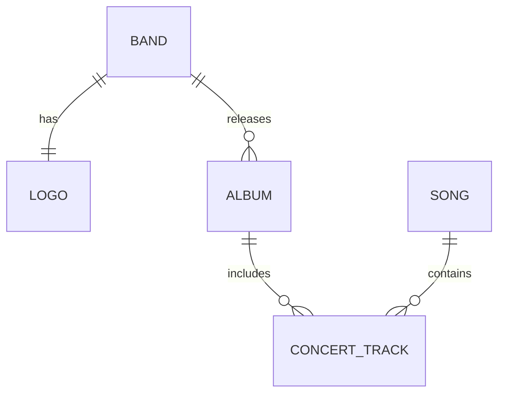
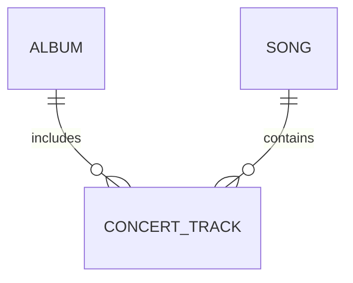
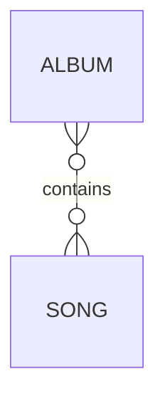
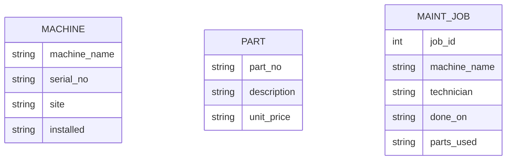
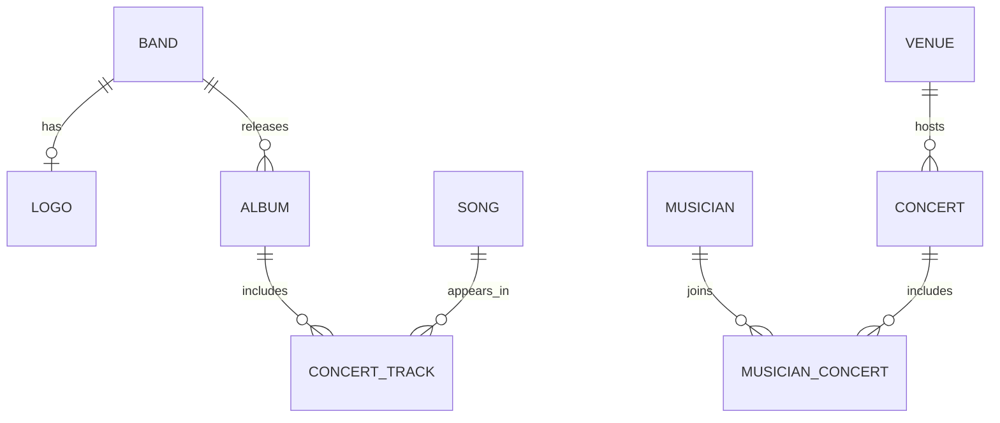

# Task 5: Mermaid ER Diagram Lab

## 1. Diagram 1: Good Design

**Why is it good?**

The diagram is easy to understand. It shows how bands, albums, and songs are connected. The `CONCERT_TRACK` table connects albums and songs.

## 2. Diagram 2: Strange Design

**Why is it strange?**

This diagram shows only the connecting table and leaves out other entities, such as `BAND` and `LOGO`. It may be confusing because it shows only part of the full music database.

## 3. Diagram 3: Wrong or Confusing Design

**Why is it confusing?**

This diagram connects albums and songs directly. It does not show the `CONCERT_TRACK` table. Because of this, some information about the relationship may be missing.

## 4. Conclusion

I learned that ER diagrams show how tables are connected. A good diagram should match the database tables and their relationships.

## 5. Schema to Diagram

I checked the tables in `legacy.db`.

The database has three tables: `machine`, `part`, and `maint_job`.

The schema does not define primary keys or foreign keys. The `parts_used` column stores many part numbers in one field.

Because the schema has no declared foreign keys, I cannot confirm the relationships from the database rules alone.

### Mermaid Diagram

This diagram shows the tables and their columns. It does not add relationships that are missing from the SQL schema.

### COUNT and Relationship Check

The three tables (`machine`, `part`, and `maint_job`) each have 4 rows.

Job 3 refers to `cnc-05`, but this machine does not exist in the `machine` table.

This happens because the database has no foreign key to enforce the relationship.

**Conclusion:** Foreign keys help prevent references to machines that do not exist.

### Parts Used Check

The `parts_used` column stores multiple part numbers in one field. This makes the data harder to search and manage.

A separate table should connect maintenance jobs and parts. This improves the database design.

### Part Table Check

The `part` table contains a duplicate part number, `P-1003`.

This happens because `part_no` has no primary key or unique constraint.

**Conclusion:** A primary key helps prevent duplicate part records.

### Maintenance Job Check

All four `job_id` values are unique in the current data. However, `job_id` has no primary key constraint, so duplicates are still possible.

**Conclusion:** A primary key enforces unique job IDs.

## Diagram to Schema

I created the SQL tables from my music ER diagram and tested them in SQLite. All 9 tables were created successfully.

The diagram does not show all details, so I added some assumptions.

**Conclusion:** The SQL tables can represent the diagram's relationships.

## Cardinality

Cardinality shows how many records can be connected.

One-to-one means one record connects to one record. One-to-many means one record can connect to many records. Many-to-many means many records can connect to many records.

For example, an album can have many songs. The exact number of songs is a business rule, not cardinality.

## Inheritance

Inheritance groups entities that share common attributes.

For example, `VEHICLE` can have subtypes such as `CAR` and `TRUCK`.

A type column is enough when the entities have few differences. Separate subtype tables are useful when they have many different attributes.

**Conclusion:** Use inheritance only when it makes the database clearer.

### Mermaid Diagram from SQL Schema

The diagram shows the relationships defined by the SQL foreign keys. The original diagram and SQL schema may differ because some details were assumed when creating the tables.

### Foreign Key Check

I ran `PRAGMA foreign_key_check;` in SQLite. No violations were returned.

The tables have valid foreign-key definitions, but the relationships still need testing with sample data.

## 6. Foreign-Key Test

- Enabled foreign keys using `PRAGMA foreign_keys = ON`.
- SQLite rejected an album with a non-existing `band_id`.
- The test confirmed that foreign-key constraints work when enabled.
